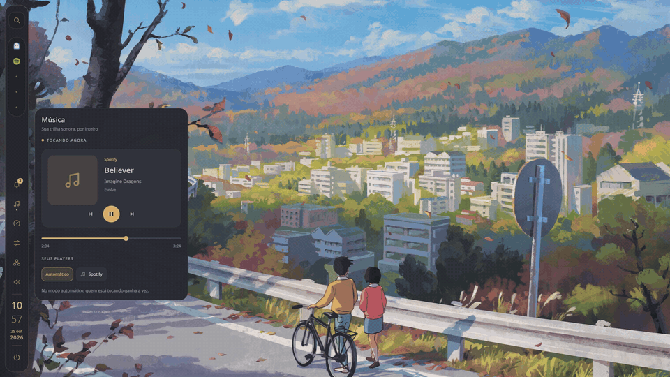
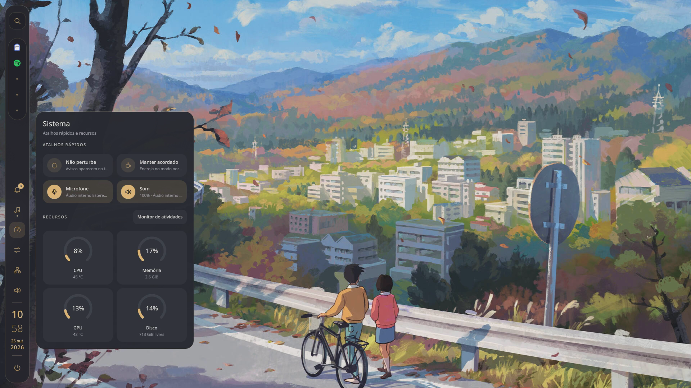
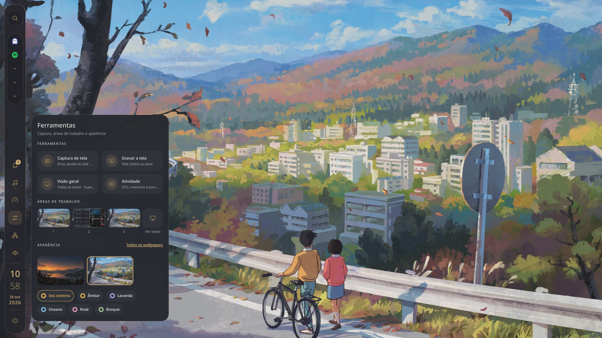
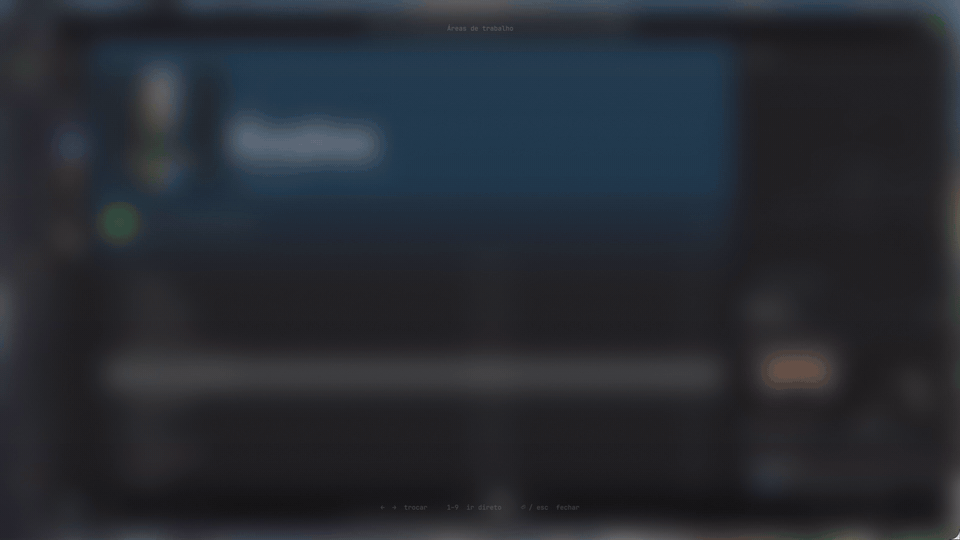
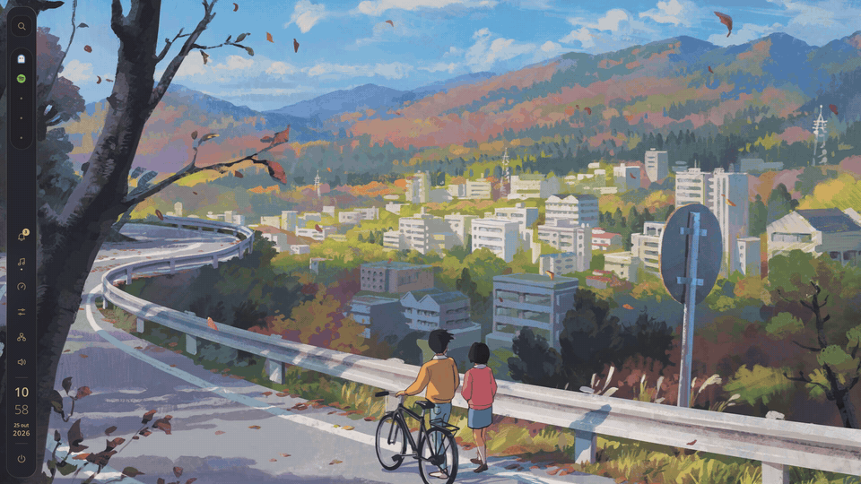
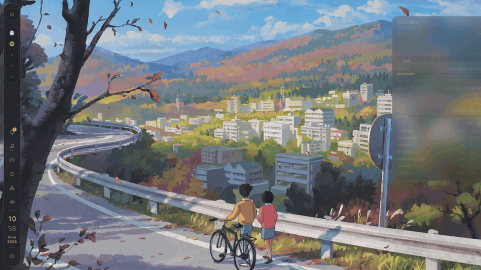

# Quickshell config

Primeira config de [Quickshell](https://quickshell.org).

Barra lateral, central de notificações, player de música, menu de energia, captura
e gravação de tela, monitor de atividade, seletor de wallpapers e temas de cor, no
Hyprland.

<p align="center">
  
</p>

<p align="center">
  🎬 <a href="docs/media/tour.mp4"><b>Vídeo completo</b></a> (1080p, 60 fps)
</p>

---

## Prévia

### Notificações
Recebe as notificações do sistema direto, sem precisar de mako ou dunst. Guarda o
histórico mesmo depois de reiniciar, agrupa por app e tem modo "Não perturbe".


### Música
Funciona com Spotify e qualquer player compatível com MPRIS. Quem estiver tocando
aparece primeiro.



### Hub da barra
Cada ícone da barra abre a sua página na gaveta lateral: sistema, ferramentas,
música e avisos.


| Sistema | Ferramentas |
| :---: | :---: |
|  |  |

### Visão geral
`Super+Tab` mostra todas as áreas de trabalho com prévias ao vivo das janelas.
As setas trocam de área e `Esc` fecha.



### Wallpapers, captura e atividade

| Wallpapers | Captura | Atividade |
| :---: | :---: | :---: |
|  |  |  |

Os vídeos em resolução cheia estão em [`docs/media/`](docs/media):
[energia](docs/media/energia.mp4) ·
[notificações](docs/media/notificacoes.mp4) ·
[música](docs/media/musica.mp4) ·
[hub](docs/media/gadgets.mp4) ·
[visão geral](docs/media/visao-geral.mp4) ·
[wallpapers](docs/media/wallpapers.mp4) ·
[captura](docs/media/captura.mp4) ·
[atividade](docs/media/atividade.mp4)

---

## O que tem

- **Barra lateral**: launcher, apps abertos (com menu no clique direito), rede, áudio, relógio e energia
- **Notificações**: toasts, histórico persistente, pilhas por app, ações e "Não perturbe"
- **Música**: capa, seek e controles para qualquer player MPRIS
- **Menu de energia**: animação de divisão celular feita em shader, navegável pelo teclado
- **Captura e gravação**: área, janela ou tela inteira
- **Monitor de atividade**: CPU, memória, rede, disco e processos
- **Visão geral** das áreas de trabalho com prévias ao vivo
- **Wallpapers** via Hyprpaper e **temas de cor** aplicados na hora

## Instalação

Dependências (Arch):

```sh
sudo pacman -S --needed quickshell hyprland hyprpaper hyprlock \
    grim slurp wl-clipboard wf-recorder \
    rofi pavucontrol network-manager-applet btop \
    ttf-jetbrains-mono-nerd
```

Clone na pasta de configs do Quickshell e rode:

```sh
git clone https://github.com/LucasCeron/Quickshell ~/.config/quickshell/config
qs -c config
```

Para abrir junto com o Hyprland, em `hyprland.lua`:

```lua
hl.exec_cmd("qs -c config")

-- atalhos da gaveta, wallpapers e bloqueio
dofile(os.getenv("HOME") .. "/.config/quickshell/config/config/gadgets-bindings.lua")
```

Ou deixe o script adicionar o `dofile` para você (ele faz backup antes):

```sh
python3 ~/.config/quickshell/config/scripts/install-gadget-shortcuts.py
```

## Atalhos

Tudo funciona por IPC, então dá para ligar em qualquer tecla:

| Tecla | O que faz | Comando |
| --- | --- | --- |
| `Super+N` | Notificações | `qs -c config ipc call gadgets notifications` |
| `Super+Shift+N` | Liga/desliga "Não perturbe" | `qs -c config ipc call notifications quiet` |
| `Super+G` | Música | `qs -c config ipc call gadgets music` |
| `Super+I` | Sistema | `qs -c config ipc call gadgets system` |
| `Super+Shift+B` | Ferramentas | `qs -c config ipc call gadgets tools` |
| `Super+Shift+T` | Temas | `qs -c config ipc call gadgets themes` |
| `Super+W` | Wallpapers | `qs -c config ipc call wallpapers toggle` |
| `Super+M` | Menu de energia | `qs -c config ipc call power toggle` |
| `Super+Tab` | Visão geral | `qs -c config ipc call overview toggle` |
| `Print` | Captura de tela | `qs -c config ipc call capture toggle` |
| `Alt+F3` | Menu da janela em foco | `qs -c config ipc call appmenu open` |
| `Super+L` | Bloquear | `bash ~/.config/quickshell/config/scripts/lock.sh` |

No menu de energia: `←` `→` navegam, `Enter` confirma, `Esc` fecha.

## Cores e temas

As cores ficam em [`common/theme/`](common/theme):

| Arquivo | Para que serve |
| --- | --- |
| [`Colors.qml`](common/theme/Colors.qml) | Todas as cores usadas na interface e os valores padrão |
| [`Presets.qml`](common/theme/Presets.qml) | Os temas prontos: Âmbar, Lavanda, Oceano, Rosé e Bosque |
| [`Typography.qml`](common/theme/Typography.qml) | Fontes e tamanhos |
| [`Motion.qml`](common/theme/Motion.qml) | Duração e curvas das animações |

O tema se troca na aba **Ferramentas → Aparência**. No tema **"Seu sistema"**, cada
cor é procurada nesta ordem:

1. `~/.config/hypr/palette.json`
2. `~/.config/palette/palette.json`
3. o valor padrão em `Colors.qml`

Basta colocar as cores que quer mudar. O que faltar ou for inválido cai para o
próximo nível, e a mudança aparece na hora, sem reiniciar:

```json
{
  "accent": "#E5B94F",
  "primary": "#FFDB89",
  "background": "#1C1C1E",
  "surface": "#2C2C2E",
  "sidebar": "#18191D",
  "textPrimary": "#F5F5F3"
}
```

Para criar um tema novo, adicione uma linha em `Presets.qml`. As outras cores
(hover, superfícies, pills) são calculadas a partir de `accent` e `bg`:

```qml
{ key: "mint", name: "Menta", subtitle: "Fresquinho", accent: "#8FE3C4", bg: "#162420" }
```

Nos componentes, as cores são importadas com namespace, para não conflitar com o
`Palette` do QtQuick:

```qml
import "../../common/theme" as Theme

Rectangle {
    color: Theme.Colors.surface
    border.color: Theme.Colors.alpha(Theme.Colors.accent, 0.4)
}
```

## Preferências

O que você muda pela interface (tema, largura e opacidade da barra, cantos,
relógio, wallpaper) é salvo em `preferences.json`, que fica fora do Git:

```json
{
  "themeName": "system",
  "maxVisibleApps": 5,
  "barWidth": 68,
  "barOpacity": 0.94,
  "barRadius": 26,
  "showClock": true,
  "doNotDisturb": false
}
```

Os programas externos (launcher, terminal, mixer, rede) e a fonte mono estão em
[`config/Defaults.qml`](config/Defaults.qml):

```qml
readonly property string terminalCommand: "ghostty"
readonly property string networkCommand: "nm-connection-editor"
readonly property string mixerCommand: "pavucontrol"
readonly property string monoFamily: "JetBrainsMono Nerd Font"
```

## Estrutura

```text
shell.qml            entrada: cria a barra e os painéis em cada monitor
config/              Settings, Defaults, atalhos do Hyprland e hyprlock
services/            singletons: notificações, mídia, áudio, rede, wallpapers...
common/
  theme/             cores, temas, fontes e animações
  components/        Button, Icon, CellHighlight
  assets/            ícones SVG, shaders e sons
modules/
  bar/               barra lateral
  gadgets/           gaveta: avisos, música, sistema e ferramentas
  notifications/     toasts e cards de notificação
  power/             menu de energia
  capture/           captura e gravação de tela
  activity/          monitor de atividade
  overview/          visão geral das áreas de trabalho
  wallpapers/        seletor de wallpapers
scripts/             lock, wallpapers, validação e instaladores
```

Cada módulo tem um `*State.qml` com o estado e o `IpcHandler` dele. Os
componentes de um módulo ficam dentro dele, e `common/` não importa nenhum módulo.

## Desenvolvimento

O Quickshell recarrega sozinho quando um `.qml` é salvo. Para ver os logs:

```sh
qs -c config log
```

Para validar os arquivos QML com o `qmlls` e testar os wallpapers:

```sh
python3 scripts/check-qml-lsp.py
python3 -B scripts/test-wallpapers.py
```

Depois de editar um shader em `common/assets/shaders/`, recompile o `.qsb`:

```sh
/usr/lib/qt6/bin/qsb --glsl "100 es,120,150" --hlsl 50 --msl 12 \
    -o common/assets/shaders/mitosis.frag.qsb common/assets/shaders/mitosis.frag
```
